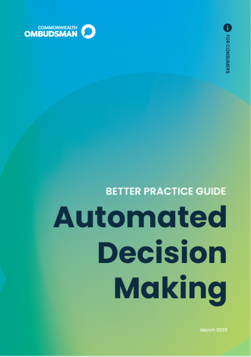
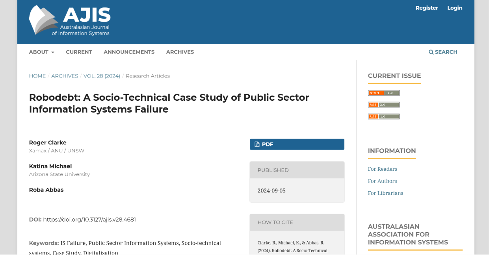
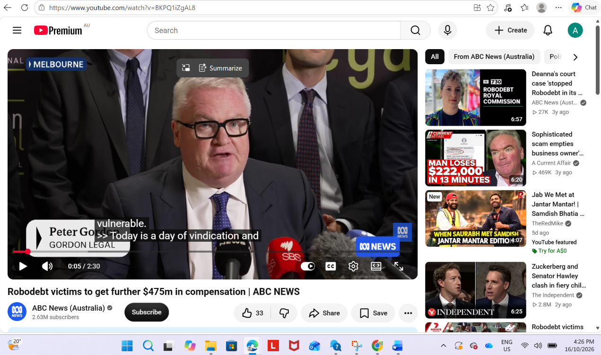
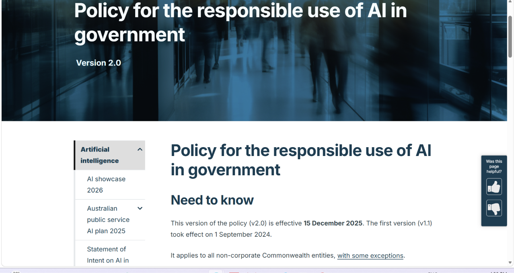
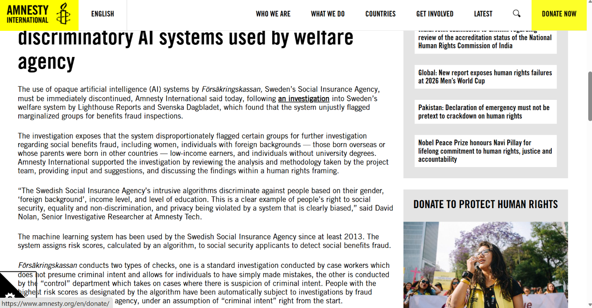
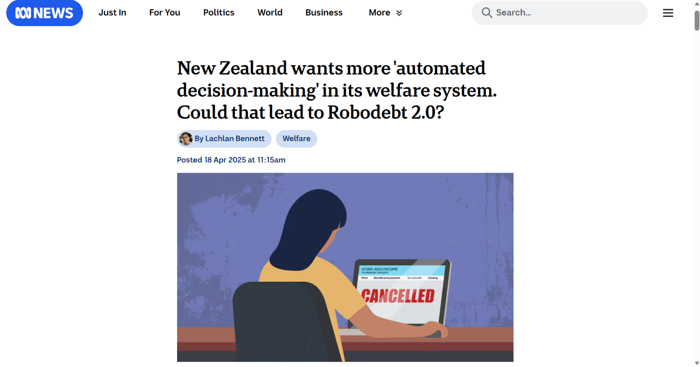

# Assessment 3 Question 2 e-portfolio – Automated Decision Making (ADM)

In this e-portfolio, I have selected six artefacts from Australia, New Zealand and Sweden to show what I have learned about Automated Decision Making (ADM) in government systems. ADM means a computer system does some or all of the work in a government decision, from suggesting an outcome to making the final decision by itself (Commonwealth Ombudsman 2025, p. 7). To be honest, when this unit started I thought ADM was just a way to make government services faster, but these artefacts slowly changed my mind. I will connect each artefact with ethical theories and my responsibilities as a future ICT professional.

# Artefact 1: Automated Decision-Making Better Practice Guide

## Screenshot

## Link

https://www.ombudsman.gov.au/__data/assets/pdf_file/0025/317437/Automated-Decision-Making-Better-Practice-Guide-March-2025.pdf

## Summary of the Artefact

This guide is from the Commonwealth Ombudsman and was updated in March 2025 with the Office of the Australian Information Commissioner and the Attorney-General's Department. It explains how Australian Government agencies should build automated systems that are legal, fair and clear to the public. It says decisions that need human judgement should usually not be fully automated, and that people should get clear reasons and a fair way to challenge a decision (Commonwealth Ombudsman 2025, pp. 15–17, 44–45).

## Justification on the Artefact

I chose this artefact because it is the main set of rules for ADM in Australia. Before reading it, I thought building these systems was mostly a technical job. Now I realise most of the work is about the law, fairness and the people affected. One weakness is that the guide is only advice, so agencies are not legally forced to follow it. This connects with Kantian ethics because explaining a decision and allowing an appeal treats people with respect, not as just another file (Quinn 2020). As a future ICT professional, I believe legal and ethical checks should happen before a system goes live.

# Artefact 2: Robodebt: A Socio-Technical Case Study of Information Systems Failure

## Screenshot

## Link

https://doi.org/10.3127/ajis.v28.4681

## Summary of the Artefact

This 2024 journal article studies Robodebt as a failed government information system. The authors explain that income averaging treated people as if they earned the same money every fortnight, which created debts that were not real (Clarke, Michael & Abbas 2024, pp. 17–18). Debt letters were sent automatically without any staff member checking them (Clarke, Michael & Abbas 2024, p. 20). The authors argue the system focused on saving money and ignored the people it affected (Clarke, Michael & Abbas 2024, pp. 25–26).

## Justification on the Artefact

I chose this artefact because it is written for information systems professionals, which is the career I am working towards. Before reading it, I mainly saw Robodebt as a political problem. Now I realise it was also a poor system design that the people building it could have questioned. As a peer-reviewed source, it gave me more depth than news reports. This connects with Act Utilitarianism because the money saved was not worth the harm caused to so many people (Quinn 2020). As a future ICT professional, I believe I must think about everyone a system affects, not only the client.

# Artefact 3: Robodebt Victims to Get Further $475m in Compensation

## Screenshot

## Link

https://www.youtube.com/watch?v=BKPQ1iZgAL8

## Summary of the Artefact

This ABC News video from 4 September 2025 reports that the Australian Government agreed to pay another $475 million to people harmed by Robodebt. It explains that the first class action in 2020 returned people's money but did not pay for the stress and hardship they suffered. The settlement still needed Federal Court approval and was described as the biggest class action payout in Australian history (ABC News 2025).

## Justification on the Artefact

I added this video because it shows that the damage from a bad ADM system can last for years. Before watching it, I thought the Robodebt story ended when the scheme stopped in 2020. Now I realise people were still waiting for proper compensation in 2025. The video is short and does not explain how the system failed, which is why I paired it with Artefact 2. This connects with Social Contract Theory because people trust the government to follow the law, and Robodebt broke that trust (Quinn 2020). As a future ICT professional, I believe cutting corners in design can cost much more later.

# Artefact 4: Policy for the Responsible Use of AI in Government

## Screenshot

## Link

https://www.digital.gov.au/ai/ai-in-government-policy

## Summary of the Artefact

This policy from the Digital Transformation Agency (DTA) explains how Australian Government agencies should use AI, including AI that helps make decisions. Version 2.0 started on 15 December 2025. Agencies must keep a list of their AI use cases, check the risks of each one, name a responsible person and publish an AI transparency statement every year. All staff must also complete responsible AI training within 12 months (DTA 2025).

## Justification on the Artefact

I chose this artefact because it shows the government trying to learn from Robodebt. Before reading it, I thought rules like this only slowed work down. Now I realise they make every agency check for risks in the same way. However, a policy only works if it is enforced, and it is too early to know if it will succeed. This connects with Rule Utilitarianism because following the same good rules leads to better results for society (Quinn 2020). As a future ICT professional, I believe ongoing training is important, which matches the ACS value of professional development (Australian Computer Society [ACS] 2014).

# Artefact 5: Discriminatory AI in Sweden's Welfare Agency

## Screenshot

## Link

https://www.amnesty.org/en/latest/news/2024/11/sweden-authorities-must-discontinue-discriminatory-ai-systems-used-by-welfare-agency/

## Summary of the Artefact

This Amnesty International article discusses a machine learning system used by Försäkringskassan, Sweden's Social Insurance Agency. The system gives benefit applicants a fraud risk score, and people with high scores are automatically investigated. An investigation by Lighthouse Reports and Svenska Dagbladet found that women, people with foreign backgrounds, low-income earners and people without university degrees were flagged more often. Amnesty called for the system to be stopped immediately (Amnesty International 2024).

## Justification on the Artefact

This one really surprised me, because it shows that ADM can be unfair even when nobody plans it that way. Before reading it, I believed a computer would be fairer than a person. Now I realise a model trained on old data can repeat unfair patterns against people who are already struggling. Amnesty is an advocacy group, but its claims are backed by an independent investigation. This connects with Kantian ethics because treating someone as a suspect because of their group does not respect them as a person (Quinn 2020). As a future ICT professional, I believe systems must be tested for bias before they are used.

# Artefact 6: New Zealand's Plan to Expand ADM in Welfare

## Screenshot

## Link

https://www.abc.net.au/news/2025-04-18/new-zealand-automation-in-welfare-robodebt-questions/105178948

## Summary of the Artefact

This ABC News article from April 2025 reports that New Zealand's Ministry of Social Development wants to use more ADM to check whether people can still receive benefits. The Ministry says a real person will always make any decision to reject someone. However, the Salvation Army, the New Zealand Law Society and academics warned that the law is too broad and could lead to another Robodebt (Bennett 2025).

## Justification on the Artefact

I chose this artefact because it shows another country learning from Australia's mistakes. Before reading it, I did not see ADM problems in different countries as connected. Now I realise Robodebt has become a warning for other governments. The law has not been fully tested yet, so this shows a risk rather than proven harm. This connects with Virtue Ethics because a good professional shows care and good judgement, not just speed (Quinn 2020). As a future ICT professional, I believe I should speak up when a system could hurt vulnerable people, in line with the ACS value of the public interest (ACS 2014).

# CQU Harvard References

ABC News (Australia) 2025, *Robodebt victims to get further $475m in compensation*, video, 4 September, viewed 16 October 2026, https://www.youtube.com/watch?v=BKPQ1iZgAL8

Amnesty International 2024, *Sweden: authorities must discontinue discriminatory AI systems used by welfare agency*, 27 November, viewed 16 October 2026, https://www.amnesty.org/en/latest/news/2024/11/sweden-authorities-must-discontinue-discriminatory-ai-systems-used-by-welfare-agency/

Australian Computer Society (ACS) 2014, *ACS code of professional conduct*, version 2.1, viewed 16 October 2026, https://www.acs.org.au/content/dam/acs/rules-and-regulations/Code-of-Professional-Conduct_v2.1.pdf

Bennett, L 2025, 'New Zealand wants more "automated decision-making" in its welfare system. Could that lead to Robodebt 2.0?', *ABC News*, 18 April, viewed 16 October 2026, https://www.abc.net.au/news/2025-04-18/new-zealand-automation-in-welfare-robodebt-questions/105178948

Clarke, R, Michael, K & Abbas, R 2024, 'Robodebt: a socio-technical case study of public sector information systems failure', *Australasian Journal of Information Systems*, vol. 28. DOI: 10.3127/ajis.v28.4681

Commonwealth Ombudsman 2025, *Automated decision-making better practice guide*, viewed 16 October 2026, https://www.ombudsman.gov.au/__data/assets/pdf_file/0025/317437/Automated-Decision-Making-Better-Practice-Guide-March-2025.pdf

Digital Transformation Agency (DTA) 2025, *Policy for the responsible use of AI in government*, version 2.0, viewed 16 October 2026, https://www.digital.gov.au/ai/ai-in-government-policy

Quinn, MJ 2020, *Ethics for the information age*, 8th edn, Pearson, United States.

# CQU Harvard References for Question 1 video

Australian Computer Society (ACS) 2014, *ACS code of professional conduct*, version 2.1, viewed 16 October 2026, https://www.acs.org.au/content/dam/acs/rules-and-regulations/Code-of-Professional-Conduct_v2.1.pdf

Quinn, MJ 2020, *Ethics for the information age*, 8th edn, Pearson, United States.
